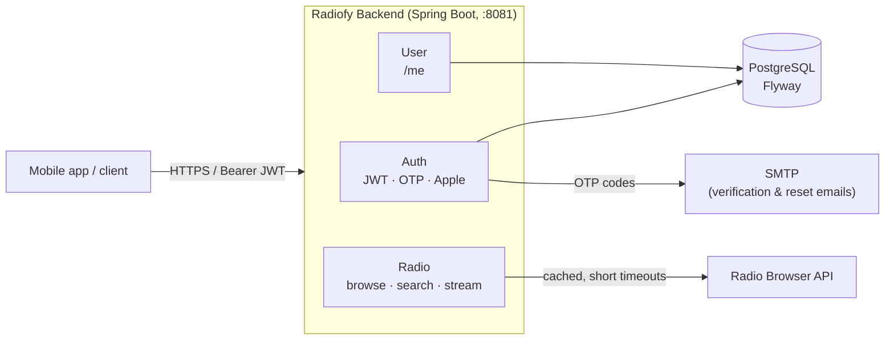

# Radiofy Backend


REST API for **Radiofy**, a radio-streaming application.
A home-grown **Spring Boot** backend that replaces the former Firebase stack:
it handles accounts and authentication, and acts as a gateway to the
[Radio Browser](https://www.radio-browser.info/) directory for searching and
playing stations.

## Tech stack

| Area        | Technology                                              |
|-------------|---------------------------------------------------------|
| Language    | Java 21                                                 |
| Framework   | Spring Boot 4.0.1 (Web MVC + WebFlux `WebClient`)       |
| Build       | Maven (wrapper `./mvnw` included)                       |
| Database    | PostgreSQL 17                                           |
| Migrations  | Flyway (`src/main/resources/db/migration`)              |
| Security    | Spring Security + JWT (JJWT 0.12)                       |
| Cache       | Spring Cache + Caffeine                                 |
| Email       | Spring Mail (SMTP)                                       |
| Testing     | JUnit 5, Testcontainers (PostgreSQL), Spring REST Docs  |
| Containers  | Multi-stage Docker + Docker Compose                     |

## Features

- **Email / password sign-up** with a mandatory OTP verification code sent by
  email before the account can log in.
- **Login** returning an *access token* (JWT) and a *refresh token*.
- **Sign in with Apple** (Apple identity-token verification, account creation or
  linking).
- **Refresh-token rotation**: tokens are stored hashed in the database,
  invalidated and reissued on every refresh, with a scheduled purge (cron).
- **Password reset** via OTP code (enumeration-safe: the response is the same
  whether or not the email exists).
- **Account deletion** (revokes all tokens, then hard-deletes the user).
- **Station catalogue** through Radio Browser: browse, search, suggestions and
  stream-URL resolution, with deduplication, caching and short timeouts
  (Radio Browser being frequently unavailable).

## Architecture



## Quick start (Docker Compose)

The simplest path: database and API both in Docker.

1. Copy the example file and fill in the variables:

```bash
cp .env.example .env
```

2. Start the stack:

```bash
docker compose --profile local up --build
```

The API then listens on **http://localhost:8081**.

## Local development (API not containerised)

Convenient for development with hot reload (Spring DevTools).

1. Start PostgreSQL only:

```bash
docker compose --profile local up db
```

2. Run the application (the `local` profile is active by default):

```bash
./mvnw spring-boot:run
```

In the `local` profile a local SMTP server is expected on `localhost:1025`
(e.g. [MailHog](https://github.com/mailhog/MailHog)), and `security.otp.echo=true`
returns the OTP code directly in the response to make testing easier.

## Environment variables

| Variable                          | Description                                            | Example / default            |
|-----------------------------------|--------------------------------------------------------|------------------------------|
| `SPRING_PROFILES_ACTIVE`          | Active Spring profile                                  | `local` / `production`       |
| `DB_USER` / `DB_PASS` / `DB_NAME` | PostgreSQL credentials (Compose)                       | `postgres` / `radiofy_db`    |
| `DB_PORT_PUBLISH`                 | Postgres port published on the host                    | `55433`                      |
| `SPRING_DATASOURCE_URL`           | JDBC URL of the database                               | `jdbc:postgresql://…`        |
| `SECURITY_JWT_SECRET`             | JWT signing secret                                     | —                            |
| `SECURITY_JWT_ACCESS_EXP_MIN`     | Access-token lifetime (minutes)                        | `15`                         |
| `SECURITY_JWT_REFRESH_LIFETIME`   | Refresh-token lifetime                                 | `30d`                        |
| `SECURITY_JWT_REFRESH_PURGE_CRON` | Cron for purging expired refresh tokens                | `0 0 3 * * *`                |
| `APPLE_CLIENT_ID`                 | Apple client ID (identity-token audience)              | —                            |
| `RADIO_BROWSER_BASE_URL`          | Radio Browser API base URL                             | —                            |
| `RADIO_BROWSER_USER_AGENT`        | User-Agent sent to Radio Browser                       | `Radiofy/1.0`                |
| `SMTP_HOST` / `SMTP_PORT`         | Outbound SMTP server                                   | `mail.infomaniak.com` / `465`|
| `SMTP_USERNAME` / `SMTP_PASSWORD` | SMTP credentials                                       | —                            |

> `.env` files are **not** versioned (see `.gitignore`). Use `.env.example` as a
> starting point.

## Endpoints

Common prefix: `/v1`.

### Authentication — `POST /v1/auth` *(public)*

| Method & path                    | Purpose                                                    |
|----------------------------------|------------------------------------------------------------|
| `POST /register`                 | Create the account + send the verification code            |
| `POST /verify-email`             | Validate the OTP code → returns access + refresh tokens    |
| `POST /verify-email/resend`      | Resend a verification code                                 |
| `POST /login`                    | Email / password login                                     |
| `POST /apple`                    | Sign in / sign up with Apple                               |
| `POST /refresh`                  | Rotation: new access / refresh pair                        |
| `POST /forgot-password`          | Request a password-reset code                              |
| `POST /reset-password`           | Set a new password via the OTP code                        |

### User — `/v1/user` *(access token required)*

| Method & path     | Purpose                            |
|-------------------|------------------------------------|
| `GET /me`         | Minimal user profile               |
| `DELETE /me`      | Delete the account                 |

### Radio stations — `/v1/radio/stations` *(access token required)*

| Method & path                  | Purpose                                              |
|--------------------------------|------------------------------------------------------|
| `GET /`                        | Browse (`countryCode`, `tag`, `limit`, `offset`)     |
| `GET /search`                  | Keyword search (`q`, `limit`, `offset`)              |
| `GET /suggest`                 | Name suggestions (`q`, `limit`)                      |
| `GET /{stationUuid}/stream-url`| Resolve a station's stream URL                       |

Protected routes expect an `Authorization: Bearer <access_token>` header.

### Monitoring

- `GET /actuator/health` — application health (liveness / readiness probes)
- `GET /actuator/info`

## Database & migrations

The schema is managed **exclusively by Flyway** (`ddl-auto: validate`; Hibernate
never alters the schema). Every change goes through a new numbered script in
`src/main/resources/db/migration` (`V1__…`, `V2__…`, …). Migrations run
automatically on startup.

## Tests

```bash
./mvnw test
```

Integration tests rely on **Testcontainers**: an ephemeral PostgreSQL container
is started automatically (Docker must be available).

## Build

```bash
# Executable jar
./mvnw clean package

# Docker image (multi-stage build)
docker build -t radiofy-backend .
```

## Project structure

```
src/main/java/io/github/fabricetiennette/radiofy/backend
├── auth        # sign-up, login, JWT, refresh tokens, OTP, Apple, password reset
├── user        # user account (entity, services, /me endpoints)
├── radio       # Radio Browser gateway (gateway, service, cache, mapping)
├── config      # security, cache, HTTP client
└── error       # global exception handling
```

## Spring profiles

| Profile       | Usage                                                              |
|---------------|-------------------------------------------------------------------|
| `local`       | Development: local SMTP, OTP echoed in the response, SQL logging  |
| `production`  | Production: Infomaniak SMTP, OTP hidden, no default values        |
